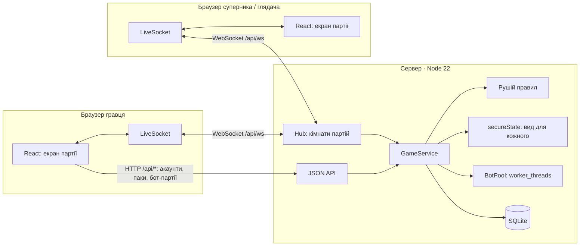
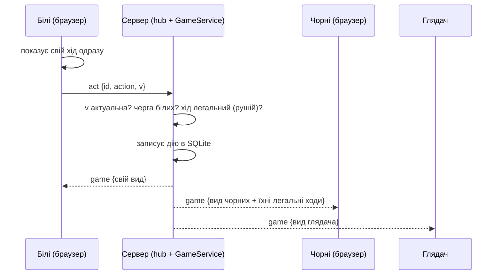

# Ultrachess

> Шахи, де кожна фігура є карткою зі своїм ходом. Збери колоду й зіграй з ботом або з людьми наживо.

**Грати:** **https://ultrachess.app** (після простою сервер прокидається кілька секунд).


Семестровий проєкт курсу «Практика програмування»: **Lab 27 — Multiplayer Browser Game**.
Вихідне ТЗ гри: [docs/spec.md](docs/spec.md), рішення щодо правил: [docs/engine-decisions.md](docs/engine-decisions.md).

## Архітектура



Один хід у партії з людиною:



## Технології

- **TypeScript** усюди: клієнт **React 19 + Vite**, сервер **Node 22** (`node:http`, `node:sqlite`), WebSocket через [`ws`](https://github.com/websockets/ws).
- Рушій правил (`src/engine`) і логіка гри (`GameService`) спільні для сервера й браузера.
- Бот: власний альфа-бета пошук у `worker_threads`.
- Тести: **Vitest** (227 тестів); деплой: Docker на Fly.io.

## Що зроблено

**Basic:** WebSocket-сервер, гравці бачать ходи одне одного за мілісекунди, сервер авторитетний,
публічна адреса, посилання на партію.

**Standard:** гра з метою (мат, пат, здача, час), пошук суперника → партія → підсумок з кубками й
паками, імена, аватари й кольори сторін, плавна анімація ходів. Шахи йдуть один на один, тому
замість 4–8 гравців у кімнаті тут **багато кімнат одночасно і глядачі** в кожній.

**Advanced:**
- **Anti-cheat:** сервер перевіряє кожну дію рушієм, сам грає за бота; клієнт не бачить чужої прихованої інформації.
- **Persistent stats:** акаунти, кубки двох ліг, історія партій, колекція (SQLite).
- **Spectator mode:** будь-хто з посиланням `#/game/<id>` дивиться партію наживо.
- **Reconnection:** сокет перепідключається, партія наздоганяє сервер.
- **Mobile:** уся гра під палець, PWA. **Bots:** 13 рівнів (~250–3000 Elo). **Chat:** реакції в партії.
- **Client-side prediction** у покроковій формі: свій хід видно одразу, сервер підтверджує або виправляє.

## Мережа

Докладно, з відповідями на питання Reflection: [docs/networking.md](docs/networking.md).

- **Тік = одна дія.** Шахи покрокові: стан змінюється лише від ходу, тож сервер реагує на кожну дію
  і розсилає новий стан лише тим, хто дивиться цю партію, і лише якщо для них щось змінилось.
- **Повідомлення.** Клієнт → сервер: `act`, `resign`, `claim`, `watch`. Сервер → клієнт: `game`,
  `error`, `matched`, `nudge`. Завдяки стисненню WebSocket оновлення важить ~150 байт.
- **Кожному свій вид** (`src/engine/secure.ts`): чужі ілюзії стають звичайними фігурами, чужі приховані
  дії зникають, версія партії є випадковим токеном.
- **Інтерполяція:** сервер шле опис руху (`fx`), клієнт плавно анімує фігуру між станами.
- **Перепідключення:** пауза росте 0,5 → 15 с, після підключення клієнт знову просить партію.

## Запуск

```bash
npm install
npm start          # збірка + сервер з базою на http://localhost:8080
npm run dev        # лише фронтенд; без сервера працює демо в браузері (дані в localStorage)
npm test           # тести
```

Мультиплеєр локально: відкрийте http://localhost:8080 у двох різних браузерах, зареєструйте два акаунти
і натисніть «Бій» у «Лізі гравців» в обох (або викличте друга з «Друзів»).

Потрібен Node 22.5+. Основні змінні оточення: `PORT`, `DB_FILE`, `ADMIN_EMAILS`, `BOT_WORKERS`,
`RESEND_API_KEY` і `MAIL_FROM` (листи), `PUBLIC_URL`, `PADDLE_*` (оплата, [docs/payments.md](docs/payments.md)).

## Деплой

Один контейнер (`Dockerfile`): Node-сервер віддає API, WebSocket і сайт; база SQLite лежить у `/data`.
На Fly.io: `fly volumes create ultrachess_data --size 1`, потім `fly deploy`. Покроково:
[docs/pre-deploy.md](docs/pre-deploy.md).

## Відомі обмеження

- **Один сервер:** кімнати живуть у пам'яті одного процесу. Для кількох серверів потрібна спільна шина
  подій (Redis pub/sub) і PostgreSQL ([масштаб](docs/networking.md#масштаб)).
- Без поштового ключа посилання з листів пишуться лише в лог сервера.
- Міраж: якщо справжній кінь оголосив шах, суперник це бачить.

**Відкрите питання до викладача:** Lab 27 написана для ігор реального часу (тік 20 Гц, 4–8 гравців у
кімнаті), а Ultrachess покрокова гра 1 на 1. Аргументи: справжній мультиплеєр через WebSocket з
авторитетним сервером, багато кімнат і глядачі, перепідключення, прихована інформація.

## Хто що зробив

Проєкт індивідуальний. **[Ім'я автора]** — ідея й дизайн гри (ТЗ, усі 70 карток і правила),
піксель-арт фігур і паків, баланс і тестування. Код написано з допомогою ШІ-асистента Claude Code
під керівництвом автора (лаби це дозволяють); автор пояснює й змінює будь-яку частину на захисті.

## Гра коротко

- **Картки:** 70 карток (69 у паках + Комета за випробування), 5 рідкостей. Колода з 16 фігур, у
  кожну позицію ставиться своя картка. Опис карток: `src/engine/cards.ts`.
- **Паки й економіка:** шанси в магазині, повторки стають уламками, золото на дошки й ефекти взяття
  (`src/economy/packs.ts`).
- **Дві ліги:** з ботом (сила бота дорівнює кубкам гравця, серія перемог дає +30 і +40) і з людьми
  (суперника шукає сервер). Налаштування: `src/economy/leagues.ts`.
- **Тиждень слави:** рейтинговий режим з понеділка 10:00 до п'ятниці 22:00 за Києвом, 5 дивізіонів,
  15 матчів і нагороди (`src/economy/weekly.ts`). **Сезони й скіни:** Сезон Берсерка.
- **Драфт з другом:** колоди збираються по картці, як драфт у Clash Royale (`src/economy/draft.ts`).
- **Випробування, досягнення, щоденні завдання, друзі, архів партій, адмін-панель.**

## Структура

```
src/engine/       рушій правил (усі картки), бот, secure.ts — вид партії для кожного
src/economy/      паки, ліги, нагороди; GameService — логіка акаунтів і партій
src/api/          клієнт: HTTP і WebSocket (live.ts) або той самий GameService у браузері
server/           Node-сервер: JSON API, WebSocket-хаб (hub.ts), потоки бота (botPool.ts), SQLite
src/ui/           React-інтерфейс
public/assets/    піксель-арт фігур, паків і ефектів
docs/             ТЗ, правила, мережа, деплой
```

## Графіка

- Піксель-арт фігур і паків надав автор проєкту; темні версії фігур згенеровано з них.
- Ефекти на дошці: **Super Pixel Effects Gigapack — Will Tice / unTied Games** та **Pixel Magic
  Effects — lordfitoi / Foozle (CC0)**. У репозиторії лише нарізані стрічки кадрів у `public/assets/fx`.
- Векторні фігури (іконки в тексті) — набір Colin M.L. Burnett (ліцензія BSD).
