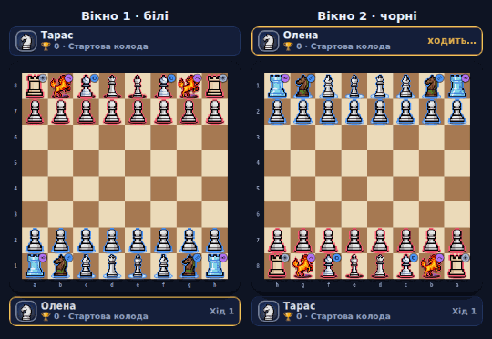
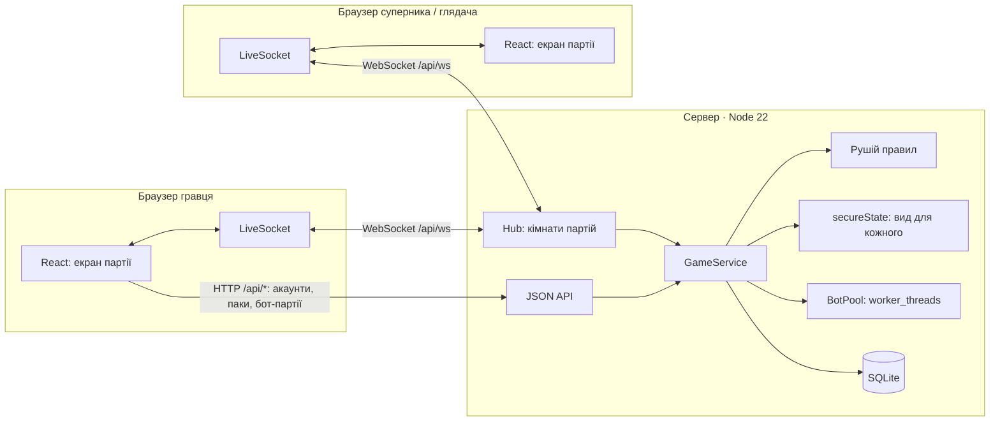
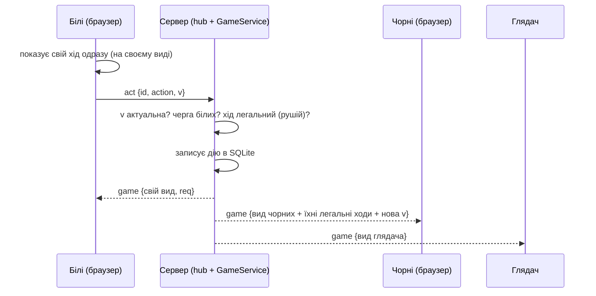

# Ultrachess

> Шахи, де кожна фігура — картка з модифікованим ходом. Збери колоду, перехитри суперника
> наживо — або дивись, як грають друзі.

**Грати:** **https://ultrachess.app** — _перше відкриття після простою займає кілька секунд:
сервер прокидається. Локально — `npm start` і http://localhost:8080._



Семестровий проєкт з курсу «Практика програмування»: **Lab 27 — Multiplayer Browser Game**. Вихідне
ТЗ гри: [docs/spec.md](docs/spec.md), рішення щодо правил: [docs/engine-decisions.md](docs/engine-decisions.md).

## Архітектура



Один хід у партії з людиною:



## Технології

- **TypeScript** усюди; клієнт — **React 19 + Vite**, сервер — **Node 22** (`node:http`, `node:sqlite`).
- **WebSocket** — пакет [`ws`](https://github.com/websockets/ws) на тому ж порту, що й API.
- Рушій правил і ігрова логіка (`GameService`) — спільний код: на сервері працюють над SQLite, у
  демо без сервера — у браузері над `localStorage`.
- Бот — власний пошук (альфа-бета з оцінкою під модифіковані правила) у `worker_threads`.
- Тести — **Vitest** (рушій, економіка, мережевий вид, сценарії карток); CI — GitHub Actions.
- Деплой — Docker (`Dockerfile`), Fly.io (`fly.toml`) або Render (`render.yaml`).

## Що зроблено

**Basic:** WebSocket-сервер, двоє бачать ходи одне одного менш ніж за секунду (на практиці
мілісекунди), сервер — джерело істини, гра в браузері на телефоні й ПК, посилання на партію.

**Standard:** справжня гра з метою (мат, пат, здача, час), пошук суперника (лобі) → партія → підсумок
з кубками й паками, імена, аватари й кольори сторін, анімації ходів замість «стрибків».
Шахи — гра для двох, тож замість 4–8 гравців у кімнаті — **багато кімнат одночасно й глядачі** в
кожній (див. [питання до викладача](#відкрите-питання)).

**Advanced (side quests):**
- ✅ **Anti-cheat:** сервер перевіряє кожну дію рушієм, сам грає за бота, клієнт не бачить чужої
  прихованої інформації; ліміти частоти запитів.
- ✅ **Persistent stats:** акаунти, кубки двох ліг, перемоги/поразки, історія, колекція (SQLite).
- ✅ **Spectator mode:** будь-хто з посиланням `#/game/<id>` дивиться партію наживо; гравці бачать 👁 N.
- ✅ **Reconnection:** обрив Wi-Fi чи перезапуск сервера — сокет перепідключається, партія
  наздоганяє сервер; хід, зроблений без зв'язку, надсилається, щойно зв'язок повертається.
- ✅ **Mobile touch controls:** уся гра під палець, нижня панель вкладок, PWA.
- ✅ **Bots:** 8 рівнів сили (~250–2000 Elo), ліга ботів і випробування.
- ✅ «Клієнтське передбачення» у покроковій формі: свій хід видно одразу, відповідь сервера
  підтверджує або виправляє його.

## Мережа

Коротко (докладно, з відповідями на питання захисту — [docs/networking.md](docs/networking.md)):

- **Тіку немає — і він не потрібен.** Шахи покрокові: стан змінюється лише від дії гравця. Сервер
  реагує на кожну дію («один тік = одна дія») і розсилає новий стан лише тим, хто дивиться цю
  партію, і лише якщо для них щось змінилось. Бот-партії йдуть звичайним HTTP «запит — відповідь».
- **Що надсилається.** Клієнт → сервер: `act {id, action, v}` (дія і версія виду, на якому її
  зроблено), `resign`, `claim`, `watch`. Сервер → клієнт: `game {вид, глядачі}`, `error`,
  `matched` (знайдено суперника), `nudge` (оновити вхідні). Вид партії після 40 півходів — ~7,3 КБ
  JSON. Стискач (permessage-deflate) пам'ятає попереднє повідомлення, тож перший вид важить ~1,7 КБ,
  а кожне наступне оновлення — ~150 байт: сервер шле повний стан, а мережею фактично йде різниця.
- **Чому сервер — джерело істини.** Він єдиний знає повний стан партії: ілюзії, увімкнену Безсмертну,
  чужі кнопки. Кожен клієнт отримує лише **свій вид** (`src/engine/secure.ts`): чужі ілюзії — звичайні
  фігури з непрозорими id, чужі приховані дії зникають з історії й анімацій. Тест перевіряє, що
  увімкнена Безсмертна не змінює вид суперника й глядача. Навіть версія `v` — випадковий
  токен, а не лічильник дій (лічильник видав би приховану дію).
- **Передбачення і узгодження.** Свій хід клієнт одразу показує на своєму виді; відповідь сервера
  замінює його. Якщо сервер не погодився (наприклад, «взята» фігура була ілюзією), дошка виправляється.
- **Анімація замість інтерполяції.** Між двома станами клієнт програє рух фігури частинами
  (ковзання, дуга, телепорт), бо сервер надсилає не лише стан, а й опис руху (`fx`).
- **Перепідключення.** `LiveSocket` перепідключається з паузою, що росте (0,5 → 15 с), і одразу — при
  події `online` чи поверненні на вкладку; після цього знову просить кожну партію й отримує її
  поточний вид. Поки сокета немає, ходи йдуть через HTTP, а партія опитується.

## Запуск

```bash
npm install
npm start          # збірка + сервер з базою даних на http://localhost:8080
npm run dev        # лише фронтенд (Vite); без сервера працює демо-режим у браузері
npm test           # тести рушія, економіки, мережевого виду й карток
```

Щоб побачити мультиплеєр локально, відкрийте http://localhost:8080 у двох різних браузерах (або
звичайне й приватне вікно), зареєструйте два акаунти, на головній оберіть «Ліга гравців» і натисніть
«Бій» в обох. Глядачем можна стати з третього вікна — за посиланням «Поділитися» з партії.

Змінні оточення сервера: `PORT` (8080), `DB_FILE` (`ultrachess.db`), `DIST_DIR` (`dist`),
`ADMIN_EMAILS` (через кому; замінює вбудований список адмінів), `BOT_WORKERS` (потоків для бота;
за замовчуванням по одному на вільне ядро, 1–4), `BOT_TIME_SCALE` (множник часу пошуку бота,
напр. `0.5` на слабкому сервері), `RESEND_API_KEY` і `MAIL_FROM` (листи через
[Resend](https://resend.com): відновлення пароля й підтвердження пошти; без ключа посилання з листів
пишуться в лог сервера), `PUBLIC_URL` (адреса сайту для посилань у листах, напр.
`https://ultrachess.app`), `PADDLE_API_KEY`, `PADDLE_CLIENT_TOKEN`, `PADDLE_PRODUCT_ID`, `PADDLE_WEBHOOK_SECRET`, `PADDLE_SANDBOX`
(Paddle: уламки за гроші, див. [docs/payments.md](docs/payments.md)), `PAYMENTS=test` (тестова оплата без грошей — лише локально).
Потрібен Node 22.5+ (`node:sqlite`).

## Деплой

Один контейнер (`Dockerfile`): Node-сервер віддає API, WebSocket і зібраний сайт, база — SQLite у `/data`.

- **Fly.io** (`fly.toml`): `fly launch --copy-config`, `fly volumes create ultrachess_data --size 1`,
  `fly deploy`. Перевірка здоров'я — `GET /api/health`, HTTPS і WebSocket проксіює сам Fly.
- **Render** (`render.yaml`): New → Blueprint. Постійний диск є лише на платних планах.
- Будь-який хостинг Docker: `docker build -t ultrachess . && docker run -p 8080:8080 -v uc:/data ultrachess`.

Покроково — [docs/pre-deploy.md](docs/pre-deploy.md).

## Відомі обмеження

- **Один сервер.** Кімнати живуть у пам'яті одного процесу, база — SQLite. Для кількох серверів
  потрібні спільна шина подій (Redis pub/sub) і інша база (див. [мережу](docs/networking.md#масштаб)).
- **Листи потребують поштового сервісу** (ключ Resend). Без нього відновлення пароля працює лише
  для того, хто бачить лог сервера.
- **Міраж і шах:** хід Міражу суперник бачить як стрибок усіх коней одразу, але якщо справжній кінь
  оголосив шах, це видно (шах не можна сховати, бо від нього залежать дозволені ходи).
- **Домовні перемоги** між своїми акаунтами в лізі гравців частково стримує денний ліміт паків.
- Перший запит після перезапуску сервера переграє партії з нуля (далі працює кеш).

### Відкрите питання

Lab 27 написана для ігор у реальному часі (тік 20 Гц, 4–8 гравців у кімнаті). Ultrachess — покрокова
гра 1 на 1. Аргументи, що вона відповідає духу лаби: справжній мультиплеєр через WebSocket з
авторитетним сервером, багато кімнат одночасно, глядачі, перепідключення, прихована інформація, яку
сервер розкриває кожному лише в межах дозволеного. Варто підтвердити це з викладачем.

## Хто що зробив

Проєкт індивідуальний. **[Ім'я автора]** — ідея й дизайн гри (ТЗ, усі 70 карток і правила),
піксель-арт фігур і паків, рішення щодо правил, тестування й налаштування балансу. Код написано з
допомогою ШІ-асистента Claude Code під керівництвом автора (лаби це дозволяють); автор пояснює й
змінює будь-яку частину на захисті.

## Гра докладно

### Сервер і два режими

- **З сервером** (`npm start`): спільні акаунти в SQLite. Паролі хешуються через scrypt, сесія
  зберігається в httpOnly-cookie. Сервер — джерело істини: він перевіряє рушієм кожен хід гравця,
  сам грає за бота й сам рахує результат, тож клієнт не може ні походити нелегально, ні «зіграти за
  бота».
- **Без сервера** (статичний хостинг): та сама логіка працює в браузері, а дані лежать у
  `localStorage`. Цей режим для демо: так опубліковано й прев'ю. У профілі є кнопка «Почати демо
  з нуля»: вона видаляє всі демо-акаунти цього браузера (зручно, щоб ще раз відкрити стартовий пак).

Сервер стискає HTML/JS/CSS і великі відповіді API (gzip; основний бандл ~424 → ~131 КБ, екран
гри й відео карток довантажуються окремо), кешує хешовані бандли назавжди, додає базові заголовки
безпеки, обмежує частоту запитів (вхід, ходи, API, повідомлення WebSocket), відкидає зміни й
WebSocket-з'єднання з чужих сайтів (перевірка `Origin`) і коректно завершується на SIGTERM. Сайт
можна встановити на телефон як застосунок (`manifest.webmanifest`, іконки, колір теми).

**Навігація.** Розділи мають адреси `#/shop`, `#/deck/style`, `#/game/<id>` тощо, але перехід
обробляє сам застосунок (`src/ui/router.ts`): спершу змінюється сторінка, а адресний рядок
оновлюється, якщо хост це дозволяє. Тому сайт працює й у вбудованих рамках, які блокують навігацію
через `#` (так відкривається демо на claude.ai). Адресу `/game/<id>` без `#` сервер перенаправляє на
`/#/game/<id>`.

### Адміністратор

Акаунт **koldmiand@gmail.com** створюється під час першого запуску з правами адміна, але поки без
пароля. Щоб увійти, зареєструйтеся з цією поштою: реєстрація встановить пароль, а права адміна
збережуться. Адмін може:
- видавати гравцям паки, усі картки, золото й уламки;
- змінювати кубки й ролі.

### Економіка

- **Стартовий пак** дається за реєстрацію: 6 карток, по одній кожної фігури. Серед них рівно 1
  рідкісна й 1 епічна, решта звичайні. Легендарних і міфологічних у ньому немає. З цих карток
  одразу збирається стартова колода.
- **Паки й шанси.** Кожна картка в паку випадає з такими шансами:

  | Пак | Карток | Звичайна | Рідкісна | Епічна | Легендарна | Міфологічна | Гарантовано | Ліміт у паку | Золото | Ціна в магазині |
  |---|---|---|---|---|---|---|---|---|---|---|
  | Звичайний | 4 | 64,5% | 25% | 8% | 2% | 0,5% | — | епічна+ ≤ 1 | 15 | 60 💎 |
  | Рідкісний | 5 | 45% | 38% | 12,5% | 3,5% | 1% | рідкісна+ | епічна+ ≤ 1 | 40 | 150 💎 |
  | Епічний | 6 | 25% | 40% | 27% | 6,5% | 1,5% | епічна+ | епічна+ ≤ 2, легендарна+ ≤ 1 | 100 | 400 💎 |
  | Легендарний | 6 | 15% | 35% | 33% | 14% | 3% | легендарна+ | епічна+ ≤ 3, легендарна+ ≤ 1 | 250 | 1000 💎 |
  | Міфічний | 5 | — | 30% | 40% | 22% | 8% | міфологічна | епічна+ ≤ 3, легендарна+ ≤ 2, міфологічна ≤ 1 | 500 | 2500 💎 |

  **Ліміт** не дає одному паку видати забагато сильних карток. «Епічна+ ≤ 1» означає: епічних,
  легендарних і міфологічних разом щонайбільше одна. Якщо випадає більше, зайві картки стають на
  рівень нижчими. Тому міфічний пак дає рівно одну міфологічну картку, щонайбільше одну легендарну і
  не більше трьох епічних і вище разом. Відсотки в таблиці — це шанс для кожної картки до
  застосування ліміту.

  Таблиця лежить у [src/economy/packs.ts](src/economy/packs.ts), там її й треба міняти.
- **Дві ліги з окремими кубками** (перемикач на головній, усі ліги — на сторінці «Ліги»):

  | | Ліга ботів | Ліга гравців |
  |---|---|---|
  | Суперник | бот, сильнішає з лігою | живий гравець (пошук суперника) |
  | Перемога / поразка | +20 / −15 кубків | +30 / −20 кубків |
  | Золото за перемогу | 10 | 20 |
  | Паки за перемоги | до 5 на день, не вище рідкісного | до 10 на день, цикл аж до легендарного |
  | Ліг | 8 | 5 |

  **Ліга ботів:** Ліга новачків (бот ~250 Elo), Дерев'яна (100 🏆, ~500), Кам'яна (250, ~750),
  Бронзова (450, ~1000), Срібна (700, ~1250), Золота (1000, ~1500), Платинова (1350, ~1750),
  Міфічна ліга ботів (1750, ~2000). З лігою росте й рідкість карток у колоді бота. Бонус за перший
  вихід у лігу — від 50 🪙 до 300 🪙 і легендарного паку.

  **Ліга гравців:** Дерев'яна, Кам'яна (300 🏆), Срібна (700), Золота (1200), Міфічна арена (2000).
  Бонус за перший вихід — від 100 🪙 з рідкісним паком до 800 🪙 з міфічним. Суперника шукає сервер:
  хто натиснув «Знайти суперника», той і стане в пару. Якщо суперник не ходить 1,5 хвилини, перемогу
  можна забрати. У демо без сервера суперником може бути лише інший акаунт у тому ж браузері.

  Бонус за лігу видається один раз: якщо впасти й піднятися знову, він не повторюється. Ліміти паків
  рахуються за UTC-днем окремо для кожної ліги. Усе налаштовується в
  [src/economy/leagues.ts](src/economy/leagues.ts).
- **Випробування** (окрема вкладка): серії перемог поспіль за уламки, поразка чи нічия завершує
  спробу. Незавершена партія не перезапускається: «Бій» повертає в ту саму партію з того ж місця.
  | Випробування | Складність | Суть | Вхід | Нагорода |
  |---|---|---|---|---|
  | Арсенал | легке | ваша колода проти ботів ~750/1000/1250 з колодами до легендарних | 💎 200 | епічний пак |
  | Класика | середнє | звичайні шахи (класичні колоди) проти ботів ~500/750/1000 | 💎 500 | легендарний пак |
  | Арена гравців | середнє | 3 перемоги поспіль у лізі гравців (живі суперники; кубки й паки ліги як завжди) | 💎 400 | легендарний пак |
  | Шлях Комети | дуже складне | ваша колода проти ботів ~1250–2000 з колодами аж до міфологічних | 💎 1200 | картка **Комета** (якщо вже є — міфічний пак) |
- **Комета** — міфологічний король, якого немає в паках (`trialOnly`). Здібність-кнопка замість ходу:
  ривок на 2–5 клітинок по прямій у будь-якому з 8 напрямків (шлях вільний, у кінці можна бити,
  на атаковану клітинку не можна), потім перезарядка 6 ходів. Спрайт — вогняний король із набору фігур.
- **Уламки 💎.** Картки прокачувати не можна, тому кожна повторка одразу стає уламками:
  звичайна 3, рідкісна 10, епічна 40, легендарна 120, міфологічна 350. За уламки в магазині
  купуються паки. Кілька повторок дають помітну частину ціни паку тієї ж рідкості, але не всю:
  4 епічні повторки — це 160 з 400 уламків за епічний пак.
- **Золото 🪙.** Випадає з кожного паку (див. таблицю, стартовий — 100) і дається за перемоги.
  За золото купуються кольори дошки (15 платних, від 300 до 2500) і ефекти взяття (9 платних, від
  250 до 2000): вибух, плазма, блискавка, череп, сердечка, джекпот, гейзер, вогняний спис, епічний
  вибух. Вибраний ефект грає щоразу, коли ваша фігура б'є; у грі з другом його бачить і суперник.
- **Щоденна вітрина магазину.** Щодня в продажу лише 3 дошки й 3 ефекти взяття, однакові для всіх
  гравців; оновлюються опівночі за UTC (у магазині видно таймер). Два дні поспіль вітрина не
  повторює жодної позиції, а за цикл (5 днів для дошок, 3 для ефектів) показує кожну. Вітрину
  рахує сервер із самої дати (`src/economy/dailyShop.ts`, без бази) і відмовляє в купівлі того, чого
  сьогодні немає у продажу. Покупка за золото — у два натискання («Купити за 🪙 N?»). Куплене
  лишається назавжди.
- **Колода й колекція** зібрані на одній сторінці, як у Clash Royale. Зверху перемикач «Колода /
  Стиль». У «Колоді» — вкладки колод (до 10, кожну можна назвати), вибрана вкладка йде в бій. Під
  ними дошка колоди, далі ваші картки, запас уламків і внизу ще не знайдені картки під замком.
  Картку можна перетягнути на дошку або натиснути її, а потім клітинку. Зміни зберігаються самі. У
  колоду можна ставити лише картки зі своєї колекції.
- **Стиль** (`#/deck/style`) — кастомізація: усі дошки й ефекти взяття, свої ставляться одним
  натисканням, чужі можна приміряти на дошці-прев'ю з фігурами вашої колоди (там же видно, чи вони
  сьогодні у продажу).
- **Головний екран — екран бою**, як у Clash Royale. Перемикач «Ліга ботів / Ліга гравців», арена
  поточної ліги (кубки, прогрес, суперник), обабіч неї кнопки: Завдання, Випробування, Тренування,
  Шанси паків (останні три відкриваються панеллю знизу). Нижче чотири слоти паків і колода в бій, а
  велика кнопка «Бій» з нагородою за перемогу завжди видна над нижньою панеллю — без прокрутки. На
  широкому екрані праворуч колода, кнопка бою й щоденні завдання.
- **Телефон.** Згори — профіль, гаманець і «?» (довідка); знизу п'ять вкладок: Магазин, Колода,
  Грати (велика кнопка посередині), Друзі, Ліги. Ліги, Випробування й Рейтинг перемикаються смужкою
  вгорі сторінки. Під час партії верхня панель ховається, щоб дошка мала більше місця.
- **Стартовий пак** після реєстрації одразу з'являється на екрані й відкривається натисканням.
- **Відкриття паку.** Епічна й сильніша картка з'являється з інтригою, яка починається одразу, щойно
  картка лягла: кімната темнішає, під карткою шкала з чотирьох кристалів (рідкісна, епічна,
  легендарна, міфологічна); вони загоряються по одному раз на ~1 с, перший — за 0,3 с. Кожен кристал б'є хвилею свого
  кольору, картка здригається, іскор більшає, фон перетікає в новий колір, напис питає «Епічна?..»,
  «Легендарна?!». Пауза після кристала однакова, чи буде ще один, чи вже переворот, тож до останньої
  миті невідомо, де шкала зупиниться. Потім зарядка (іскри стягуються до картки, звук наростає), один
  плавний переворот на півтора оберти, і під спалахом — дві хвилі, вибух, промені, відблиск по
  картці; легендарна й міфологічна додають феєрверки, міфологічна ще й трусить екран. Натискання
  одразу відкриває картку (крім перших 0,9 с — щоб не пропустити інтригу тим самим тапом, яким
  гортали попередню картку); «Усі картки ⏭» веде одразу до підсумку. З вимкненими анімаціями (чи системним «зменшити рух») картки відкриваються
  без інтриги.

### Матч

- На початку бою карти суперника по черзі вилітають великими на екран і «сідають» на дошку: фігури
  з'являються на своїх клітинках. Порядок: пішаки, тури, коні, слони, король, ферзь. Коли все
  розставлено, гра починається сама. Кнопка «Пропустити» одразу веде до гри. Бот не ходить, поки
  триває заставка. З вимкненими анімаціями заставки немає.
- Платформи левітації стоять за краєм дошки й не налазять на клітинки: поки на дошці є платформи
  або куди на них можна піти, рамка навколо дошки розширюється.
- Хто б'є фігуру на платформі, стає на цю платформу й стоїть там, поки вона існує; коли платформа
  зникає, він повертається на клітинку, з якої бив (або падає, якщо клітинку зайнято). Король б'є,
  не сходячи з місця.
- Хто б'є ілюзію, стає на її клітинку.
- Фігури рухаються так, як ходять: кінь і все, що перестрибує, летить дугою; слони, тури й ферзі
  ковзають; портал і телепорт зникають і з'являються. Складні ходи граються по частинах: Стінобіг
  стрибає до стіни й тоді біжить, Берсерк б'є першу фігуру, потім другу, рикошет доходить до краю й
  відскакує, Скакун робить два стрибки. Збита фігура стоїть, доки до неї не дійде удар; ефект
  взяття грає саме в цю мить. Виштовхнута фігура рушає, коли штовхач уже приїхав.
- Складні ходи обираються на дошці крок за кроком. Спершу підсвічуються лише перші зупинки
  (стіна для Стінобігу, перша жертва Берсерка, край дошки для рикошету, кут повороту, клітинка
  взяття для Дуеліста чи снайпера). Фігура стає туди й показує, куди можна йти далі: натисніть її
  ще раз, щоб зупинитись, або підсвічену клітинку, щоб продовжити. Перетворення пішака
  обирається з маленького меню над клітинкою.
- Кнопки здібностей стоять угорі бічної панелі, міфічні виділені.

### Профіль і друзі

- **Профіль:** аватар (будь-яка ваша картка), нікнейм, публічний код `#ABC123`, рекорд кубків,
  статистика, колекція за рідкістю, історія матчів і налаштування (звук, анімації, координати).
- **Акаунт:** підтвердження пошти листом, «Забули пароль?» (посилання на 1 годину, діє один раз),
  зміна пароля й пошти (з поточним паролем), «вийти на всіх інших пристроях», видалення акаунта
  (відкриті партії здаються, пошта й нікнейм стираються, суперники бачать «Видалений гравець»).
- **Нікнейм:** 3–24 символи (літери, цифри, пробіл, `_ . -`), без матів і без імен на кшталт
  «Адмін» чи «Бот»; змінювати можна раз на 7 днів. Правила — `src/economy/account.ts`.
- **Захист акаунтів:** паролі — scrypt, щонайменше 8 символів і не з переліку найпоширеніших; вхід
  відповідає однаково довго для існуючої й неіснуючої пошти; «Забули пароль?» не каже, чи є акаунт;
  посилання з листів зберігаються лише як хеш; ліміти на вхід, листи й дії з паролем.
- **Щоденні завдання:** три на день (зіграти партії, перемогти, відкрити паки, зіграти з другом),
  нагорода — золото або уламки.
- **Друзі:** пошук за нікнеймом або кодом, заявки, статус «онлайн / був N хв тому», профіль
  гравця з рейтингу чи списку друзів.
- **Гра з другом:** виклик приймається з активною колодою, кольори випадкові. Хід іде на сервер
  через WebSocket, сервер перевіряє його рушієм і одразу надсилає новий вид партії обом гравцям і
  глядачам (див. [мережу](#мережа)). Кубків дружні партії не змінюють. Кожна партія має свою адресу
  `#/game/<id>`: за нею гравець повертається в гру, а будь-хто інший дивиться. У розділі «Друзі» є
  список «Друзі грають зараз». У демо без сервера друзі — це акаунти одного браузера, а партія
  оновлюється опитуванням.

### Бот

Вісім рівнів сили з кроком ~250 Elo: Мартін (~250, як на chess.com: 1 хід наперед, не дораховує
розміни, часто ходить випадково), Новачок (~500), Учень (~750), Любитель (~1000), Клубний гравець
(~1250), Досвідчений (~1500), Кандидат у майстри (~1750), Майстер (~2000). У тренуванні рівень
обирається на головній. У лізі ботів він залежить від ліги. Адміністратор може на головній примусово
вибрати рівень бота ліги для себе (для тестів).

Бот думає **на сервері**: клієнт надсилає свій хід (`POST /api/matches/:id/action`), сервер перевіряє
його рушієм, рахує відповідь бота в окремому потоці (`server/botPool.ts`, `worker_threads`, щоб пошук
не блокував інших гравців) і повертає запис партії. Запис зберігається в базі, тому партію в лізі
ботів чи у випробуванні можна продовжити після перезавантаження сторінки або обриву зв'язку —
клієнт сам повторює запит і наздоганяє сервер. `BOT_TIME_SCALE` (наприклад, `0.5`) зменшує час
пошуку на слабкому сервері. У демо без сервера той самий код рахує бота у web worker.

### Структура

```
src/engine/       рушій правил (усі 70 карток), бот, secure.ts — вид партії для кожного глядача
src/economy/      паки, ліги, нагороди; GameService — уся логіка акаунтів і партій
src/api/          клієнт: HTTP і WebSocket (live.ts) до сервера або той самий GameService у браузері
server/           Node-сервер: JSON API, WebSocket-хаб (hub.ts), потоки бота (botPool.ts), SQLite
src/ui/           React-інтерфейс
public/assets/    піксель-арт фігур, паків і ефектів
docs/             ТЗ, трактування правил, мережа, чекліст деплою
```

### Графіка

- Піксель-арт фігур і паків надав автор проєкту. Де в наборі є темна пара фігури, чорні беруть її;
  для решти згенеровано «обсидіанові» версії (`p{N}d.png`): яскравість переведено в темну
  фіолетово-сріблясту палітру з часткою рідного відтінку, тож текстура лишається видимою.
- Ефекти на дошці (взяття, землетрус, затемнення, міраж, щит, підказка, шах, феєрверк, паки):
  **Super Pixel Effects Gigapack — Will Tice / unTied Games** та **Pixel Magic Effects —
  lordfitoi / Foozle (CC0)**. У репозиторії лише нарізані стрічки кадрів у `public/assets/fx`.
- Векторні фігури (іконки в тексті) — набір Colin M.L. Burnett (ліцензія BSD).
