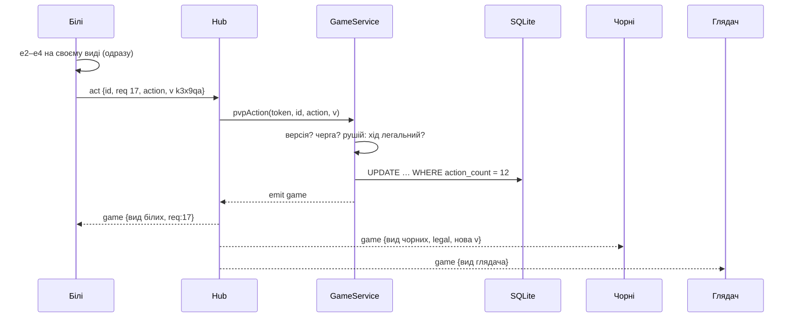

# Мережа Ultrachess

Докладно про те, як партії з людьми йдуть мережею, і підказки до питань захисту Lab 27
(«пройдіть один тік», «один кадр», «чому сервер — джерело істини», «масштаб»).

## Два канали

| Канал | Для чого | Файли |
|---|---|---|
| HTTP `POST/GET /api/*` | акаунти, паки, колоди, бот-партії й випробування, пошук суперника, а також **запасний шлях** для ходів, поки WebSocket недоступний | `server/index.ts`, `src/api/client.ts` |
| WebSocket `/api/ws` | партії з людьми (друзі й ліга гравців), глядачі, сповіщення «знайдено суперника» й «оновити вхідні» | `server/hub.ts`, `src/api/live.ts` |

Бот-партіям WebSocket не потрібен: суперник — сам сервер, тож на кожен хід гравця одна HTTP-відповідь
уже несе й хід бота.

Обидва канали ведуть в один `GameService` (`src/economy/service.ts`): він перевіряє дії, пише в SQLite і
будує **вид** партії для кожного, хто дивиться.

## Протокол WebSocket

Клієнт → сервер:

| Повідомлення | Що робить |
|---|---|
| `{t:'watch', id}` | підписатися на партію (гравець або глядач); сервер одразу відповідає її поточним видом |
| `{t:'unwatch', id}` | відписатися |
| `{t:'act', id, req, action, v}` | хід або здібність; `v` — версія виду, на якому його зроблено |
| `{t:'resign', id, req}` | здатися |
| `{t:'claim', id, req}` | забрати перемогу, якщо суперник мовчить 90 с (ліга гравців) |

Сервер → клієнт:

| Повідомлення | Коли |
|---|---|
| `{t:'game', game, watchers, req?}` | новий вид партії; з `req` — відповідь на ваш запит |
| `{t:'error', id, req?, status, error}` | дію відхилено (і одразу за ним — справжній стан партії) |
| `{t:'matched', id}` | вам знайшли суперника або прийняли ваш виклик |
| `{t:'nudge'}` | змінилися вхідні (виклик, заявка в друзі, хід у вашій партії) |

`game` несе `PvpState`: хто грає (імена, аватари, кубки, колоди), статус і **вид** —
`{you, state, legal, v}`:

- `state` — позиція так, як її дозволено бачити саме вам (див. нижче);
- `legal` — ваші легальні ходи, лише коли ваша черга (які ходи дозволені, вирішує сервер);
- `v` — випадковий токен версії, лише коли ваша черга.

Розмір: вид партії після 40 півходів — ~7,3 КБ JSON. З'єднання стискається (permessage-deflate), і
стискач пам'ятає попередні повідомлення. Тому перший вид важить ~1,7 КБ, а кожне наступне оновлення
тієї самої партії — ~100–200 байт: сервер завжди шле повний стан (простіше й надійніше), а мережею
фактично йде лише різниця. Повідомлення йде лише тим, хто дивиться саме цю партію, і лише якщо для них
щось змінилось.

## Один «тік»: білі ходять e2–e4

У Lab 27 тік — це крок симуляції сервера 20 разів на секунду. У покрокових шахах світ змінюється лише від
дії гравця, тож тут **тік = обробка однієї дії**. Ось вона від кліку до екранів усіх трьох учасників.

1. **Клік.** `MatchPage.tsx`, `act()`: клієнт одразу застосовує хід до свого виду
   (`performAction(matchRef.current, action)`) — гравець бачить фігуру на e4 без очікування мережі — і
   ставить дію в чергу `send()`. Черга гарантує, що дії йдуть по одній і в тому порядку, в якому їх
   зроблено.
2. **Відправлення.** `PvpGame.tsx` → `live.act(id, action, v)` (`src/api/live.ts`): у сокет іде
   `{t:'act', id, req: 17, action, v}`. Якщо сокета зараз немає — `TypeError`, і той самий запит іде через
   HTTP `POST /api/pvp/:id/action`.
3. **Сервер приймає.** `Hub.handle()` (`server/hub.ts`): повідомлення від з'єднання, яке при підключенні
   пройшло перевірку `Origin` і сесії (cookie). Ліміт — 120 повідомлень за 25 с, розмір — до 256 КБ.
4. **Перевірка.** `GameService.pvpAction()`:
   - ви гравець цієї партії, і вона ще йде;
   - `v` збігається з поточною версією (ви ходили на актуальній позиції, а не на застарілій);
   - партія переграється рушієм із запису дій (з кешу: доходиться лише нове), черга — ваша;
   - `performAction(state, action)` — рушій сам перевіряє, що хід легальний; якщо ні — `400 «Такий хід
     неможливий»`.
5. **Запис.** Дія дописується в SQLite умовним оновленням
   `UPDATE pvp … WHERE id = ? AND action_count = ?` (`server/sqliteStore.ts`, `updatePvp`). Якщо дві дії
   прийшли одночасно (дві вкладки), запишеться лише одна, друга отримає `409` і свіжий стан.
6. **Подія.** `emit({type:'game', id, users})` → `Hub.onEvent` → `broadcast(id)`.
7. **Розсилка.** Для кожного з'єднання, яке дивиться партію, `push()` будує його вид
   (`pvpState` → `secureState(state, колір або null)`), порівнює з останнім надісланим цьому з'єднанню і
   надсилає, лише якщо він змінився. Автор ходу отримує відповідь із `req: 17`.

Виміряно на сервісі (без мережі): перевірка й запис ходу ~0,8 мс, вид для одного глядача ~0,5 мс.
Між двома браузерами на одній машині хід з'являється в суперника за кілька мілісекунд.

## Один кадр: повідомлення прийшло до чорних

1. `LiveSocket.receive()` розбирає JSON і викликає слухачів цієї партії.
2. `PvpGame` передає вид у `MatchPage`: якщо в чорних самих є запит у дорозі, повідомлення пропускається
   (їхня відповідь принесе те саме), інакше `receive(view)` → `setServer(view)`, `setMatch(view.state)`.
3. React перемальовує екран: дошку, годинник, історію, кнопки здібностей. Підсвітка ходів береться з
   `view.legal`, тобто з сервера.
4. `Board.tsx` бачить новий `fx` (опис останньої дії: хто звідки куди, якими частинами, які ефекти) і
   програє його один раз: `GlidePiece` будує ключові кадри (ковзання, дуга стрибка, телепорт) і запускає
   їх через Web Animations API (`el.animate`). Далі кадри малює сам браузер на частоті екрана, без
   власного циклу `requestAnimationFrame` і без нових повідомлень з сервера.

Це покроковий аналог **інтерполяції**: між двома станами сервера клієнт показує плавний рух, а не
стрибок фігури.

## Передбачення й узгодження

- **Передбачення:** свій хід клієнт показує одразу (крок 1 вище).
- **Узгодження:** відповідь сервера повністю замінює показане. Зазвичай вони збігаються. Коли ні —
  наприклад, ви «взяли» фігуру, яка була ілюзією, або суперник встиг здатися — дошка показує те, що
  сказав сервер, а клієнт ніде не «тримається» за свою версію.
- **Застаріла позиція:** якщо дію зроблено на старому виді, сервер відповідає `409`, і клієнт одразу
  отримує справжній стан.

## Прихована інформація

Деякі картки ховають інформацію від суперника: Ілюзіоніст і Міраж ставлять ілюзії, Безсмертна вмикає
щит потай, Підказка не видна суперникові. Тому клієнт **ніколи** не отримує повний стан партії, а лише
свій вид — `secureState()` у `src/engine/secure.ts`:

- чужі ілюзії стають звичайними фігурами; усі чужі фігури отримують непрозорі id, тож справжню фігуру
  від копії не відрізнити й за id;
- чужий прихований стан (щит, ілюзії) порожній, чужі приховані відкати кнопок прибрано;
- чужі приховані дії вилучено з історії, а анімація показує останню **публічну** дію (`fxPublic`);
- чужий Міраж показано як стрибок усіх коней одразу: підсвітка (`lastMove.spread`), запис «Кінь g1 —
  Міраж» і анімація не видають, куди пішов справжній кінь;
- версія `v` — випадковий токен, а не номер дії: лічильник видав би, що суперник щось зробив потай;
- прихована дія не змінює час останньої активності партії (його видно в списку партій);
- хаб надсилає повідомлення лише тоді, коли вид змінився — тож на приховану дію суперника не прийде
  взагалі нічого.

Тест `src/engine/__tests__/secure.test.ts` перевіряє: після увімкнення Безсмертної вид чорних і глядача
дорівнює виду до неї. Тест у `src/economy/__tests__/social.test.ts` перевіряє те саме через сервіс.

## Перепідключення

- **Клієнт** (`LiveSocket`): коли сокет закрився, він перепідключається через 0,5 с, 1 с, 2 с … до 15 с, а
  одразу — коли браузер повідомляє `online` або вкладка знову стає видимою. Після підключення він
  знову надсилає `watch` для кожної відкритої партії й отримує її поточний вид — екран наздоганяє сервер.
- **Поки зв'язку немає:** у партії показано «Перепідключення…», вид опитується через HTTP раз на 3 с,
  а зроблений хід надсилається повторно (до 10 спроб з паузою, що росте). Повтор безпечний: хід,
  який сервер уже прийняв, змінив версію, тож дубль буде відхилено, а клієнт отримає стан.
- **Сервер:** раз на 25 с пінгує кожне з'єднання; хто не відповів на попередній пінг — закривається
  (телефон, що втратив мережу). Партія від цього не страждає: вона в SQLite, а не в з'єднанні.
- **Перезапуск сервера** (деплой): на SIGTERM хаб закриває сокети з кодом 1001, клієнти
  перепідключаються до нового процесу, а той переграє партії із записів у базі.

## Чому сервер — джерело істини

1. **Чесність.** Клієнт можна змінити (DevTools, власний скрипт). Тому клієнт лише просить: «хочу цей
   хід». Рішення — за рушієм на сервері; нелегальний хід, хід не в свою чергу чи на старій позиції
   відхиляється.
2. **Прихована інформація.** Якби стан рахував клієнт, у нього мав би бути повний стан — з ілюзіями й
   щитом суперника. Сервер же надсилає кожному лише його вид.
3. **Одна історія.** Дві вкладки, обрив зв'язку, одночасні дії — сервер упорядковує їх (версія +
   умовний запис), і всі бачать ту саму партію.
4. **Результати.** Кубки, паки й статистику рахує сервер; клієнт не може «повідомити про перемогу».

## Масштаб

Зараз: один процес Node, один SQLite. Партія в пам'яті — це лише кеш переграних станів і множини
з'єднань, тож процес легко перезапустити.

- **100 одночасних партій.** Без змін. Хід коштує ~1–3 мс CPU (перевірка + види для двох гравців і
  кількох глядачів); навіть якщо всі ходять раз на кілька секунд, процесор майже не зайнятий.
  Найважче — бот-партії: пошук бота йде в окремих потоках (`server/botPool.ts`), їх кількість задає
  `BOT_WORKERS`.
- **1000.** Один сервер ще тягне живі партії (порядку сотень ходів за секунду на ядро), але варто:
  - будувати вид один раз на роль (білі, чорні, глядач), а не на кожне з'єднання — зараз однаковий вид
    для 50 глядачів рахується 50 разів;
  - мережа вже передає фактично лише різницю (див. «Розмір» вище), але сервер щоразу будує й
    серіалізує повний вид — тут допоможе надсилати лише нову дію + `fx`;
  - винести ботів на окремі машини або обмежити чергу (бот — головний споживач CPU).
- **10 000.** Кілька серверів за балансувальником:
  - кожна партія «живе» на одному сервері (маршрутизація за `id` партії), щоб кеш і розсилка були
    локальними; або спільна шина подій (Redis pub/sub), щоб хід, прийнятий одним сервером, дійшов до
    глядачів, підключених до іншого;
  - замість SQLite — PostgreSQL (кілька записувачів), сесії — там же або в Redis;
  - пошук суперника — окремий сервіс із чергою.

## Помилки, які довелося розв'язати

- **Прихована інформація «просочувалася» не через стан, а через побічні канали:** кількість дій у партії
  (номер версії) і час останньої активності видавали, що суперник увімкнув Безсмертну; анімація
  прихованої дії показувала її. Рішення — випадкова версія, незмінний час активності, `fxPublic` і
  розсилка лише змінених видів, плюс тест «вид до == вид після».
- **Бот раптом грав слабко на сервері:** потік бота під `tsx` не міг імпортувати рушій і тихо падав у
  запасний «тупий» режим. Рішення — реєструвати `tsx` у потоці явно й писати в лог, коли спрацьовує
  запасний режим.
- **Кеш переграних партій віддавав чужий стан,** коли в тестах змінювались колоди тієї самої партії. Рішення
  — підпис налаштувань партії в ключі кешу.

## Відомі обмеження мережі

- Глядач бачить партію лише з акаунтом (посилання + вхід); анонімного перегляду немає.
- Один процес: кімнати не переживають масштабування на кілька серверів без шини подій (див. вище).
- Міраж: якщо справжній кінь оголосив шах, суперник це бачить (див. `docs/engine-decisions.md`).
